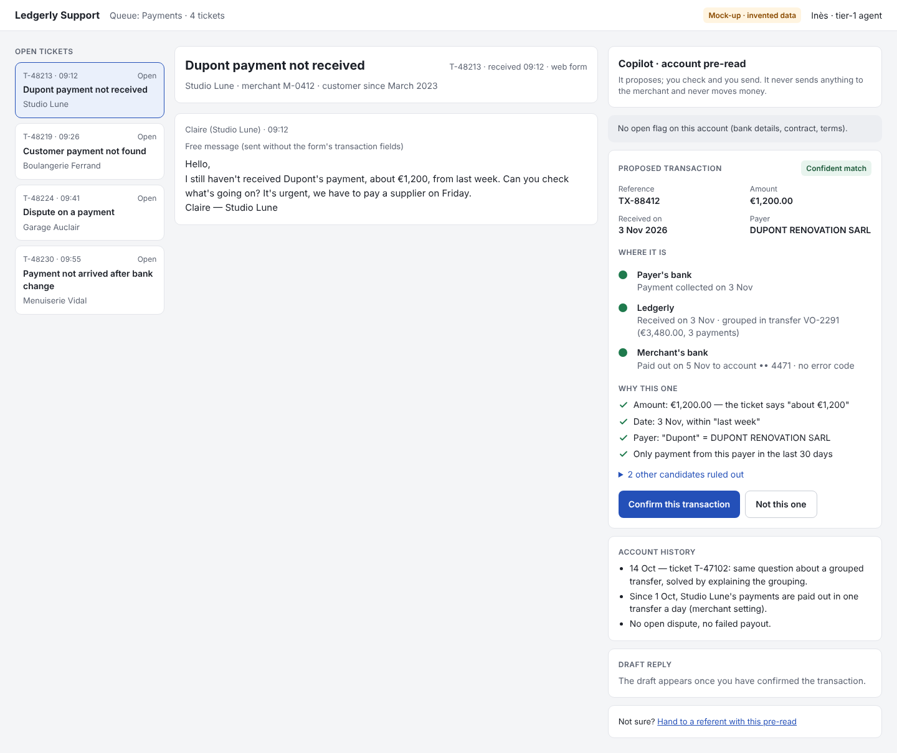

# 03 — Prototype link · Ledgerly agent-assist copilot

> One clickable prototype of the surface (the copilot side panel inside the agent's ticket view), then tried by two of our three users (A and B) on one task, thinking aloud. Results: `03_user_research.md`, usability test.

- **Link:** https://claude.ai/artifact/DPC2VoJNzroT5WhLmGREoK
- **Same file in the repo:** `prototype/mock_up_prototype/03_mockup_v0.1.html`
- **Made with:** Claude (in a conversation)
- **Version:** v0.1, the version tested with A and B
- **Data:** all invented. No model behind it: every screen is scripted.



## The first prompt
I'd like you to help me write a meta-prompt to create a prototype in an html file. 
Please again this repository on this branch : https://github.com/dhiabencheikh/Data-AI-Product-P2/tree/5-assignment-3
Enclosed you'll find some other guidelines to make this maquette as well. 
The info I need in the maquette are already in the .md files, and you find several tickets in eval_set.csv
Inspire youself with this ticket but don't take the same infos if is very important. Create 4 differents that take different errors. The first one as to be when the tickets is with text free with no other infos given in the form, make a very small mistakes not in the results but in the part where the transactions similar are given. The result has to be true, but not a subtle element. It could be something like a person thinks she didin't receive the money, but she received in a grouped virement with others.
Please follow strictetly the guides in the repo already written and don't make important choices by yourself, if you hesitate or ask a question, I prefer you to ask me. 
I let you handle the design as you want, just it should be easy to use and strait to the point, but still exhaustive. The user should catch all the important info in one sight. 
Do not realize the mock-up just the meta prompt we're going to perfectionne it.
Ask me as many relevant questions as you want to do so.
Also, read thes files to guide you from the repo, please mind inconsistencies you may find. Don't handle it yourself please, just tell me and ask to choose the direction to take.
Please be really carefull and exhaustive on this 4 tickets given exhaustive infos about the entrance and also the model repsonses. It has to be based on the interviews as well to sounds real and relevant.


## The final Meta-prompt 
Written from our repo (`03_product_brief.md` v2, `spec.md`) so that it gives the v0.1 mockup as tested, screen by screen.

````text
Build a clickable mock-up of one screen for a usability test. Deliver ONE self-contained HTML file: inline CSS
and vanilla JavaScript, no library, no external font, image or request. In English. All data invented. Keep all
state in memory (no localStorage). Title: "Ledgerly — agent inbox with the copilot (prototype)".

1. CONTEXT
Ledgerly is a B2B payments platform with 800 merchants and 12,000 support tickets a month. Inès, a tier-1
support agent, spends about 40 % of her handling time searching the ledger, payouts and past tickets to find
which payment the merchant means and where it is stuck. The copilot pre-reads the account when the ticket
arrives and shows, in a side panel of the ticket view she already uses: open account flags first, the
transaction it believes the merchant means with its evidence, where the payment is (payer's bank → Ledgerly →
merchant's bank), the account history, and a draft reply. Trust levels: matching and drafting are L2 (the
copilot proposes, the agent confirms and approves). Refunds, chargebacks, disputes and bank-change cases are
human only. The copilot never sends anything to the merchant and never moves money: only the agent presses
Send. When it is not sure, it says "No confident match" and proposes no draft.

2. LAYOUT (desktop, 1440 px wide, columns wrap on narrow screens)
- Header, white with a bottom border. Left: "Ledgerly Support" (bold) and "Queue: Payments · 4 tickets"
  (muted). Right: a small amber tag "Mock-up · invented data" and "Inès · tier-1 agent".
- Three columns below:
  - Left, max 320 px: label "Open tickets", then one button per ticket: "ref · time" on the left and its
    status on the right ("Open", "Answered" after Send, "Handed over" after a hand-over), the subject in
    bold, the merchant in muted text. The selected ticket has a light blue background and a blue border.
  - Centre: a card with the subject as a title, "ref · received time · web form" on the right, and
    "merchant · merchant ID · customer since …" below. Then a card with "sender · time", the form line in
    small muted text, and the merchant's message. After Send, the sent reply appears below in a light blue
    card "You · time". After a hand-over, an internal note card: "Internal note · not visible to the merchant"
    / "Handed to a referent with the copilot pre-read attached."
  - Right: the copilot panel. It always starts with a card "Copilot · account pre-read" and the line "It
    proposes; you check and you send. It never sends anything to the merchant and never moves money."

3. STYLE
Background #F4F5F7; white cards, 1 px border #E3E5EA, radius 10 px, 16 px padding; text #1B1F27, muted
#5B6270; Inter or system font, 14 px. Accent blue #2450B8 (hover #1A3C8C, light #EAF0FB); green #1F5C3C on
#E8F4EE; amber #6B3A00 on #FFF4E0 with border #F0D3A1. Small uppercase labels for the sections. Buttons
44 px high: primary filled blue, secondary white with a grey border, plus a text-link style. Visible focus
outline. Tags: green "Confident match", blue "Confirmed by you", grey "No confident match". "Where it is"
is a vertical chain of three stages with a dot each: green = done, orange = stopped there, grey = not
reached. Evidence lines start with a green check icon. In the draft, references and amounts are
highlighted in a blue pill.

4. THE FOUR TICKETS (the first one is selected when the page opens)

T-48213 · 09:12 · "Dupont payment not received" · Studio Lune · merchant M-0412 · customer since March 2023 ·
from "Claire (Studio Lune)" · form line "Free message (sent without the form's transaction fields)" ·
message: "Hello, I still haven't received Dupont's payment, about €1,200, from last week. Can you check
what's going on? It's urgent, we have to pay a supplier on Friday. Claire — Studio Lune"
Panel:
- Grey banner: "No open flag on this account (bank details, contract, terms)."
- Card "Proposed transaction", tag "Confident match": Reference TX-88412 · Amount €1,200.00 · Received on
  3 Nov 2026 · Payer DUPONT RENOVATION SARL. "Where it is": Payer's bank "Payment collected on 3 Nov" (done) ·
  Ledgerly "Received on 3 Nov · grouped in transfer VO-2291 (€3,480.00, 3 payments)" (done) · Merchant's
  bank "Paid out on 5 Nov to account •• 4471 · no error code" (done). "Why this one": Amount: €1,200.00 —
  the ticket says "about €1,200" · Date: 3 Nov, within "last week" · Payer: "Dupont" = DUPONT RENOVATION
  SARL · Only payment from this payer in the last 30 days. A collapsed section "2 other candidates ruled
  out": TX-88390 · €1,150.00 · 2 Nov · DUPUIS & FILS — different payer; TX-88021 · €1,200.00 · 20 Oct ·
  DUPONT RENOVATION SARL — outside "last week". Buttons: "Confirm this transaction" (primary) and "Not
  this one" (secondary).
- Card "Account history": "14 Oct — ticket T-47102: same question about a grouped transfer, solved by
  explaining the grouping." · "Since 1 Oct, Studio Lune's payments are paid out in one transfer a day
  (merchant setting)." · "No open dispute, no failed payout."
- Card "Draft reply". Before confirming: "The draft appears once you have confirmed the transaction."
  After "Confirm this transaction" (the tag becomes "Confirmed by you" and the two buttons disappear):
  "Hello Claire,

  The payment of €1,200.00 from DUPONT RENOVATION SARL (ref. TX-88412) was received on 3 November. It was
  paid out to your account ending in 4471 on 5 November, grouped with two other payments in a single
  transfer of €3,480.00 (ref. VO-2291). That is the amount you will see on your bank statement.

  Kind regards,
  Inès — Ledgerly Support"
  with the note "Highlighted references are filled in from the ledger, not typed.", a green check line
  "Checked: no refund or chargeback promised", and buttons "Send" and "Edit". "Edit" turns the draft into
  a textarea labelled "Edit the draft before sending it", the button becomes "Done editing", and the edits
  are kept. "Send" shows "Reply sent by you at 09:21 · TX-88412 linked to the ticket and logged." in a
  green banner and puts the reply in the centre column.
- While the match is not confirmed: a small card "Not sure? Hand to a referent with this pre-read" (link
  button).
- "Not this one" replaces the match card with "No transaction selected" / "The ticket works as it does
  today: search the merchant's ledger. Nearby payments found:" and the list TX-88412 · €1,200.00 · 3 Nov ·
  DUPONT RENOVATION SARL; TX-88390 · €1,150.00 · 2 Nov · DUPUIS & FILS; TX-88021 · €1,200.00 · 20 Oct ·
  DUPONT RENOVATION SARL, with buttons "Open the merchant's ledger" (does nothing) and "Back to the
  proposal". The draft card then says "No draft without a confirmed transaction. Write the reply as usual."

T-48219 · 09:26 · "Customer payment not found" · Boulangerie Ferrand · merchant M-0157 · customer since June
2024 · from "Paul (Boulangerie Ferrand)" · form line "Free message (no form fields)" · message: "Hello, A
customer tells me he paid me €480 at the start of November but I can't see anything. Could you have a look
please? Thanks, Paul"
Panel: the grey no-flag banner · card "Proposed transaction", tag "No confident match": "3 payments of
€480.00 between 2 and 4 Nov, from 3 different payers. The ticket does not say who the customer is: the
copilot does not choose for you." · list TX-88301 · €480.00 · 2 Nov · M. ROUX · paid out 4 Nov;
TX-88355 · €480.00 · 3 Nov · SCI LES TILLEULS · paid out 5 Nov; TX-88437 · €480.00 · 4 Nov · A. NGUYEN ·
paid out 6 Nov · "No draft proposed. Ask the merchant for the customer's name or the reference, or search as
usual." · buttons "Open the merchant's ledger" and "Hand to a referent" · card "Account history": "2 tickets
in 2026, none about a missing payment." · "No open dispute, no failed payout." No draft card.

T-48224 · 09:41 · "Dispute on a payment" · Garage Auclair · merchant M-0733 · customer since January 2022 ·
from "Mr Auclair (Garage Auclair)" · form line "Form fields: reference TX-87655 · amount €2,350.00 · date
28 Oct" · message: "Hello, A customer has opened a dispute on the €2,350 payment of 28 October. The repair
was done: I want you to reject this dispute and pay me the money. Regards, Mr Auclair"
Panel: the grey no-flag banner · amber banner "Human decision only: dispute (chargeback). The copilot
prepares the file; it decides nothing." · card "Proposed transaction", tag "Confident match": TX-87655 ·
€2,350.00 · 28 Oct 2026 · P. LEROY; "Where it is": Payer's bank "Dispute opened on 6 Nov" (stopped) ·
Ledgerly "Funds on hold while the dispute is reviewed" (stopped) · Merchant's bank "Not paid out" (not
reached); "Why this one": Reference given in the form: TX-87655 · Amount and date match exactly · Only open
dispute on the account; buttons "Confirm this transaction" / "Not this one" ("Not this one" lists
TX-87655 · €2,350.00 · 28 Oct · P. LEROY) · card "Applicable rule": "Dispute policy §4.2: the merchant has
10 days, until 16 Nov, to send supporting documents. Ledgerly passes them on; the payer's bank decides." ·
draft card, same behaviour as T-48213, with:
  "Hello Mr Auclair,

  The dispute concerns the payment of €2,350.00 of 28 October (ref. TX-87655). It was opened on 6 November
  by your customer's bank, and the funds are on hold while it is reviewed.

  To respond, please send us the invoice and the work order signed by your customer before 16 November.
  We will pass your file on; the decision belongs to your customer's bank.

  Kind regards,
  Inès — Ledgerly Support"
  and an amber warning line "Guardrail: the request "reject this dispute" is not repeated. No outcome is
  promised." Send shows "Reply sent by you at 09:48 · TX-87655 linked to the ticket and logged." · the
  "Not sure? Hand to a referent with this pre-read" card while not confirmed.

T-48230 · 09:55 · "Payment not arrived after bank change" · Menuiserie Vidal · merchant M-0291 · customer
since May 2021 · from "Léa (Menuiserie Vidal)" · form line "Form fields: reference TX-90410 · amount
€4,800.00 · date 4 Nov" · message: "Hello, The €4,800 payment of 4 November has not arrived. We changed bank
last week, is that the problem? Léa — Menuiserie Vidal"
Panel: amber banner first: "Open flag on this account: bank details change in progress — new IBAN pending
verification since 2 Nov. Check this before anything else." · card "Proposed transaction", tag "Confident
match": TX-90410 · €4,800.00 · 4 Nov 2026 · BATIMAT OUEST; "Where it is": Payer's bank "Payment collected on
4 Nov" (done) · Ledgerly "Received on 4 Nov · payout VO-3372 sent on 6 Nov" (done) · Merchant's bank "Sent to
the OLD account •• 8812 — the new IBAN was not verified yet" (stopped); a grey box "Why no draft: money
already sent to the old account cannot be recalled by support. A referent must handle bank-change cases.";
one primary button "Hand to a referent with this pre-read". No confirm button, no draft · card "Account
history": "2 Nov — bank details change requested by the merchant (pending verification)." · "No open
dispute."

5. HAND-OVER (any ticket)
"Hand to a referent…" replaces the panel content (below the banners) with a card "Handed over" / "The ticket
is with a referent, with this pre-read attached. Nothing was sent to the merchant." and a button "Take the
ticket back", which returns to the proposal. The queue shows "Handed over" and the centre column shows the
internal note.

6. BEHAVIOUR
Each ticket keeps its own state (review → confirmed → sent, or rejected, or handed over) when the agent
switches tickets. Use real <button> elements, aria-labels on the three columns, aria-current on the selected
ticket, and 44 px click targets.
````

## What you can click
- **T-48213 · Studio Lune** — confident match with "where it is" (grouped transfer), "why this one", candidates ruled out, account history, draft with references filled in from the ledger, Send and log. **This is the task of the usability test.**
- **T-48219 · Boulangerie Ferrand** — "no confident match", no draft, the question to ask the merchant.
- **T-48224 · Garage Auclair** — dispute: "human decision only", the policy clause, a draft that promises no outcome.
- **T-48230 · Menuiserie Vidal** — open flag first (bank change): no draft, hand to a referent.

## Task given in the test
> "Ticket T-48213: Studio Lune says it has not received Dupont's payment of about €1,200 from last week. Handle the ticket until the reply is sent."

What the testers found and what changes in v0.2: `03_user_research.md` (T1–T8) and `03_product_brief.md` §9.
